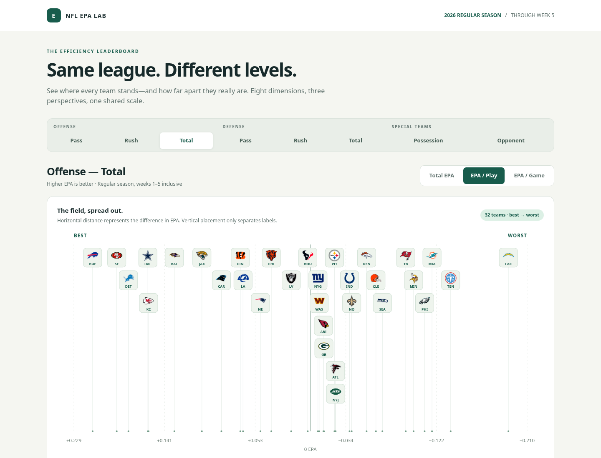

# NFL EPA Leaderboards

A standalone HTML site with eight dimension tabs, three metric toggles (EPA/play by default), and a horizontal team-distance plot above each table. Best teams are always on the left; defensive EPA allowed reverses the numeric direction. Team labels retain exact EPA coordinates, with vertical separation only to avoid overlaps. Real team logos appear in the plot and table, with names and abbreviations for clarity. Select a team in the plot or table to highlight it. View state is saved in the URL fragment for sharing.



## Open the HTML site

Download `docs/index.html` using GitHub’s **Download raw file** button and open it in a browser. The file contains the data, CSS, and JavaScript; no install, backend, network request, or build is required to view it. JavaScript must be enabled.

Alternatively, serve it locally from the repository root:

```sh
python -m http.server 8000 --directory docs
```

For a hosted site, enable **Settings → Pages → Deploy from a branch → main → /docs** in this GitHub repository. The files are ready for Pages, but pushing them does not enable hosting.

## Rebuild the site

```sh
python build_site.py
```

The builder uses the committed CSV snapshot and export provenance in `reports/` and `web/index.template.html`, producing the self-contained `docs/index.html`. To refresh the data, run the export command below and then rebuild. Edit the template rather than the generated HTML.

Team EPA for the **2026 regular season, through Week 5 inclusive**. The current dashboard focuses on leaderboards; matchup work is paused.

[View all eight leaderboards and actual values](reports/epa_2026_through_week_5.md) or [download the full CSV](reports/epa_2026_through_week_5.csv).

## Run the Python dashboard (alternative)

```sh
cd /workspace/nflverse
python -m venv .venv
.venv/bin/pip install -e '.[dev]'
.venv/bin/streamlit run app.py --server.address 0.0.0.0
```

Eight dimension tabs: offense pass/rush/total, defense pass/rush/total, special teams possession-side/opponent-side. Every team has total EPA, EPA/play, EPA/game, separate ranks for each measure, play count, and game count. Select the measure to rank and chart; tables are also sortable by clicking headers. All dimensions are downloadable as CSV. Bars retain real EPA distances and are centered on zero.

Offense: higher is better. Defense retains raw EPA allowed: lower is better. Special teams possession-side EPA uses `posteam` and higher is better; opponent-side EPA uses `defteam` and lower is better. These are **not fixed kicking and receiving units**: on kickoffs the receiving team is posteam; on punts the punting team is posteam. Includes punts, kickoffs, field goals and extra points. Possession total minus opponent total produces net special teams EPA. ST EPA/play is exploratory; samples and play mixes differ.

EPA/play = sum of EPA / count of qualifying plays with non-null EPA. EPA/game = sum of EPA / all completed team games in weeks 1–5, including games with no plays in a particular dimension, accounting for byes. No plays yields null EPA/play; no games yields null EPA/game and no rank. Ties use competition ranks. Pass/rush flags follow nflverse, including sacks and scrambles. No garbage-time or opponent adjustments.

Data loads through nflreadpy, refreshed hourly or through the sidebar button. Ignored raw Parquet caches live in `data/raw/`. Only completed games are aggregated; missing play-by-play for completed games blocks the dashboard. Current completeness checks detect entirely missing games, not partial files. The date filter excludes future weeks but uses current stat corrections, not an archived historical snapshot. Network access to GitHub and its release asset hosts is required. Source retrieval time is displayed.

## Export and validate

```sh
.venv/bin/python export_leaderboards.py
python build_site.py
.venv/bin/pytest -q
```

Export produces the reviewable Markdown and CSV snapshots under `reports/`. These are actual source data, unlike the older fabricated HTML design studies in `prototypes/`. The earlier pregame aggregation API remains in `metrics.py` for future matchup work.

## Browser validation

```sh
.venv/bin/pip install -e ".[dev,browser]"
# Requires system Chromium on PATH (or install Chromium for this machine).
.venv/bin/python tests/browser/check_site.py
```

The browser check serves the static site temporarily and verifies all 24 dimension/metric combinations, exact linear horizontal positions, label separation, correct sorting, keyboard interaction, team highlighting, CSV download, URL state, and mobile overflow.

## Logos

All 32 team logos are bundled as original PNGs from nflverse/nflplotR and embedded in the standalone HTML, so they work offline without CDN access. The build verifies their SHA-256 checksums. See [logo source and attribution](web/assets/logos/README.md) and [source manifest](web/assets/logos/sources.json). Team marks belong to their respective owners.
