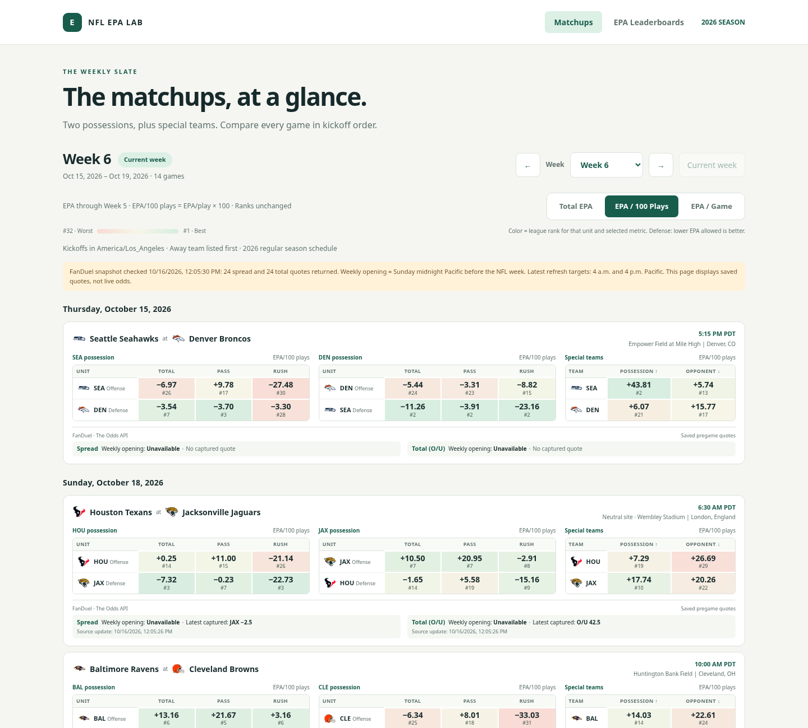

# NFL EPA Lab

A standalone HTML site with **Matchups** as the default view and **EPA Leaderboards** as a second top-level section. The leaderboard has eight dimension tabs, three metric toggles (EPA/100 plays by default), and a horizontal team-distance plot above each table. Best teams are always on the right; defensive EPA allowed reverses the numeric direction. Team labels retain exact EPA coordinates, with vertical separation only to avoid overlaps. Real team logos appear in the plot and table, with names and abbreviations for clarity. Select a team in the plot or table to highlight it. View state is saved in the URL fragment for sharing.



[Leaderboard preview](docs/preview.png)

## Open the HTML site

Download `docs/index.html` using GitHub’s **Download raw file** button and open it in a browser. The file contains the data, CSS, and JavaScript; no install, backend, network request, or build is required to view it. JavaScript must be enabled.

Alternatively, serve it locally from the repository root:

```sh
python -m http.server 8000 --directory docs
```

For a hosted site, enable **Settings → Pages → Deploy from a branch → main → /docs** in this GitHub repository. The files are ready for Pages, but pushing them does not enable hosting.

## Matchups and the current week

The published 2026 schedule currently has **272 regular-season games across all 18 weeks**. Select a week, step backward/forward, or return to the current week. Games are grouped by the visitor's local calendar date and ordered by kickoff; times include the visitor's timezone abbreviation. Each game shows two compact possession tables (Total/Pass/Rush columns, offense/defense rows), a 2×2 special teams table (team rows, possession/opponent columns), team logos, saved FanDuel spread/total panels, and stadium with city/state (or city/country for international games). Venue locations are maintained in `venue_locations.py`, keyed by stadium rather than home team; unknown venues display Location TBD. Bye teams are listed below the slate.

The opening week is calculated in the browser at visit time, not at build time. NFL weeks roll over **Tuesday at midnight America/New_York**, using the first scheduled game of each week to locate that Tuesday. October 16, 2026 selects Week 6. Before the season, Week 1 is selected; after the published season, the final week is selected. Explicit week links preserve the chosen week. The page also checks for a new week while left open.

The schedule is a snapshot, not a live feed. Refresh and rebuild for flex scheduling changes. Unknown kickoff times stay TBD; playoff rounds are included once published by the source. Matchup cells show the selected EPA value and league rank, with a continuous rank-based heat map (green = stronger, red = weaker). Defense and opponent-side special teams use lower-is-better ranks. On mobile the tables stack. EPA data remains through Week 5: Weeks 1–5 leave matchup EPA unavailable to avoid hindsight; Week 6 and later clearly label the saved through-Week-5 snapshot. Historical pregame snapshots have not been generated. The metric selector is shared with the leaderboard and persists in links. Old leaderboard links still work.

## FanDuel betting quotes and refresh schedule

The updater requests NFL `spreads,totals` from **FanDuel (`fanduel`)** through The Odds API. The first FanDuel pull returned both markets for all 24 upcoming events. The old Polymarket US snapshot is preserved separately in `reports/odds_polymarket_us_2026.json`; histories are never mixed.

The site displays **Weekly opening** and **Latest captured**:

- Latest-line refresh targets: **4 a.m. and 4 p.m. America/Los_Angeles**, automatically handling PST/PDT.
- Weekly opening target: **Sunday at 12:00 a.m. Pacific before that NFL week's Tuesday start**. Week 6's target was October 11, 2026; Week 7's is October 18. No past opening is reconstructed from today's quotes.
- The opening capture accepts only quotes whose provider update timestamp is at or before the midnight cutoff and which are collected within 15 minutes after it. Otherwise the opening stays unavailable. Once captured, opening is immutable while latest values change. First-observed quotes remain stored for audit but are not relabeled as weekly opening.
- Future opening targets display as pending. Missing markets never fall back to other books. Quotes must be pregame, and older provider updates cannot replace newer values.

The checked-in [GitHub Actions workflow](.github/workflows/refresh-odds.yml) uses UTC candidate slots with a Pacific-time gate. Wrong-season DST candidates and duplicate latest captures in the same hour skip API calls. Scheduled jobs skip outside the published season. GitHub cron is best effort: jobs can be delayed or dropped, so this does not guarantee execution at exact wall-clock time. Missing the opening window leaves the opening unavailable. Manual workflow dispatch fetches latest only.

### Activate on GitHub

1. Under **repository Settings → Secrets and variables → Actions**, create repository secret **`ODDS_API_KEY`** with your API key. The cloud environment secret does **not** automatically transfer to GitHub. Never put the value in chat, HTML, source code, or command-line arguments.
2. Ensure Actions are enabled and workflow pushes to `main` are permitted by repository rules. In **Actions → Refresh FanDuel NFL odds**, use **Run workflow** to verify GitHub-side access. This session's GitHub API access did not permit checking secret names or starting a remote run; local credentials and scheduled execution are distinct.
3. For automatic hosting updates, enable Pages with **GitHub Actions** as the build source and create Actions repository variable **`PUBLISH_PAGES=true`**. The optional deploy job uploads `docs/` and deploys it explicitly. A `GITHUB_TOKEN` commit alone does not trigger branch-based Pages builds. Without that variable, snapshots and HTML still update in the repo; no deployment is claimed.

Each normal refresh currently costs two credits (two markets). Twice daily uses about **4 credits/day**, plus **2 for the weekly opening pull**. The first FanDuel pull left 486 credits remaining. No historical paid endpoint is required for forward collection.

### Manual refresh

```sh
.venv/bin/python export_odds.py
python build_site.py
# Sunday opening job only; validates the cutoff/window before saving any opening:
.venv/bin/python export_odds.py --capture-opening
```

The build embeds sanitized `reports/odds_2026.json` in the HTML. Keep this file between runs: it preserves opening, first-observed, and latest quote history per game/market. The browser makes no API calls and contains no API key. Refresh failures preserve the prior file. Events map by both teams and kickoff within 24 hours; ambiguous matches are skipped. Home-negative points mean home favored, unlike nflverse's spread convention. The UI shows the favored team's spread or Pick’em, and totals as O/U. Schedule/EPA data remain separate snapshots and are not refreshed by the odds job.

## Rebuild the site

```sh
python build_site.py
```

The builder uses the committed EPA CSV, schedule JSON, and export provenance in `reports/` and `web/index.template.html`, producing the self-contained `docs/index.html`. To refresh the data, run the export command below and then rebuild. Edit the template rather than the generated HTML.

Team EPA remains scoped to the **2026 regular season, through Week 5 inclusive**.

[View all eight leaderboards and actual values](reports/epa_2026_through_week_5.md) or [download the full CSV](reports/epa_2026_through_week_5.csv).

## Run the Python dashboard (alternative)

```sh
cd /workspace/nflverse
python -m venv .venv
.venv/bin/pip install -e '.[dev]'
.venv/bin/streamlit run app.py --server.address 0.0.0.0
```

Eight dimension tabs: offense pass/rush/total, defense pass/rush/total, special teams possession-side/opponent-side. Every team has total EPA, EPA/100 plays, EPA/game, separate ranks for each measure, play count, and game count. Select the measure to rank and chart; tables are also sortable by clicking headers. All dimensions are downloadable as CSV. Bars retain real EPA distances and are centered on zero.

Offense: higher is better. Defense retains raw EPA allowed: lower is better. Special teams possession-side EPA uses `posteam` and higher is better; opponent-side EPA uses `defteam` and lower is better. These are **not fixed kicking and receiving units**: on kickoffs the receiving team is posteam; on punts the punting team is posteam. Includes punts, kickoffs, field goals and extra points. Possession total minus opponent total produces net special teams EPA. ST EPA/100 plays is exploratory; samples and play mixes differ.

EPA/100 plays = 100 × sum of EPA / count of qualifying plays with non-null EPA. This is exactly EPA/play multiplied by 100, with the same ranks and heat-map colors. It is a rate, not a projection of a 100-play game. Raw `epa_per_play` and its rank remain in the underlying CSV/API for compatibility; the product controls, plots, and downloadable leaderboard tables use `epa_per_100_plays` and its rank. EPA/game = sum of EPA / all completed team games in weeks 1–5, including games with no plays in a particular dimension, accounting for byes. No plays yields null EPA/100 plays; no games yields null EPA/game and no rank. Ties use competition ranks. Pass/rush flags follow nflverse, including sacks and scrambles. No garbage-time or opponent adjustments.

Data loads through nflreadpy, refreshed hourly or through the sidebar button. Ignored raw Parquet caches live in `data/raw/`. Only completed games are aggregated; missing play-by-play for completed games blocks the dashboard. Current completeness checks detect entirely missing games, not partial files. The date filter excludes future weeks but uses current stat corrections, not an archived historical snapshot. Network access to GitHub and its release asset hosts is required. Source retrieval time is displayed.

## Export and validate

```sh
.venv/bin/python export_leaderboards.py  # Only when refreshing the Week 5 EPA snapshot
.venv/bin/python export_schedule.py     # Refresh the season schedule independently
python build_site.py
.venv/bin/pytest -q
```

Exports produce the reviewable Markdown/CSV EPA snapshots and `schedule_2026.json` under `reports/`. Kickoff timestamps are converted from nflverse Eastern game times to explicit UTC instants, including daylight saving time, before bundling. These are actual source data, unlike the older fabricated HTML design studies in `prototypes/`. The earlier pregame aggregation API remains in `metrics.py` for future matchup work.

## Browser validation

```sh
.venv/bin/pip install -e ".[dev,browser]"
# Requires system Chromium on PATH (or install Chromium for this machine).
.venv/bin/python tests/browser/check_site.py
.venv/bin/python tests/browser/check_matchups.py
.venv/bin/python tests/browser/check_odds.py
.venv/bin/python tests/browser/check_matchup_tables.py
```

The leaderboard browser check serves the static site temporarily and verifies all 24 dimension/metric combinations, exact linear horizontal positions, label separation, correct sorting, keyboard interaction, team highlighting, CSV download, URL state, and mobile overflow.

The matchup browser check covers all 272 games and 18 weeks, chronological ordering, every week rollover including DST, default Week 6, pre/post-season bounds, explicit-week links, week navigation, local kickoff times in Los Angeles and Tokyo, mobile layout, and backward-compatible leaderboard links.

Odds tests cover Pacific schedule slots across DST, duplicate-run guards, strict Sunday opening cutoffs, immutable weekly openings and first observations, line movement, home/away sign conventions, missing markets, stale updates, pregame-only captures, bookmaker isolation, and credential-safe errors. The browser test checks real FanDuel quotes, pending/missed openings, plus injected synthetic quotes (never saved to the product), favorite changes, totals, Pick’em, stale warnings, and no browser API calls.

The three-table browser check verifies all 224 Week 6 cells across all three metrics, correct offense/defense pairings, special teams, rank/color consistency, the 100× conversion, historical unavailable states, shared selectors, preserved FanDuel panels, and desktop/tablet/mobile layouts. The original `designs/` files remain archived mockups; `docs/index.html` is the current product.

## Logos

All 32 team logos are bundled as original PNGs from nflverse/nflplotR and embedded in the standalone HTML, so they work offline without CDN access. The build verifies their SHA-256 checksums. See [logo source and attribution](web/assets/logos/README.md) and [source manifest](web/assets/logos/sources.json). Team marks belong to their respective owners.
